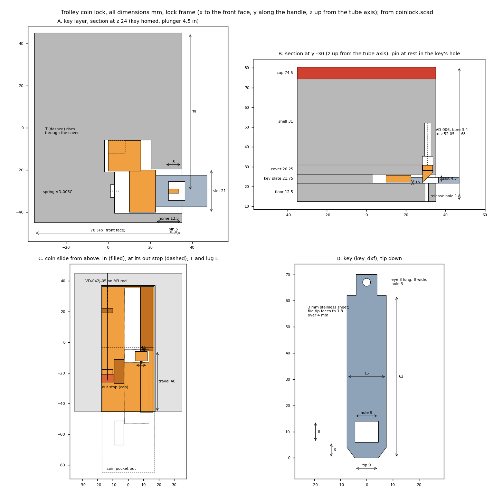

# Building the real coin lock

The real trial uses a printed lock whose contact geometry is the simulation's: `coinlock.scad` holds the scene's
numbers under the same names as `trolley.py` (in mm), and `test_trolley.py` (class `Cad`) checks every one of them
against the scene and checks the plunger, tooth, lug, coin pocket and pin against the sim's own shapes. No
commercial lock is needed or measured. `make.sh` regenerates `stl/`, `key.dxf` and `drawing.svg`/`.png` (OpenSCAD
2021.01 or later, Python 3 with matplotlib). STLs are in assembly position, in the lock frame (x toward the front
face with the slot, y along the handle, z up from the tube's axis).

## Parts

| Part | Qty | What | Source |
|---|---|---|---|
| floor_plate | 1 per lock | floor, handle saddle, chain tab, pin release hole | print |
| clamp_lower | 1 per lock | lower half of the handle clamp | print |
| key_plate | 1 per lock | key slot 21 x 4.5 mm, plunger way, arm pocket, spring recess | print |
| cover_plate | 1 per lock | tooth slot (its ends are the plunger's 0 and 6 mm stops), pin bores | print |
| shell | 1 per lock | slide channel, end wall, pin spring bore | print |
| cap | 1 per lock | red top, slide out-stop block | print (red) |
| plunger | 1 | body, arm, tooth T, spring cheeks | print, 100% infill |
| slide | 1 | coin pocket, lug L and rail, spring post | print, 100% infill |
| pin | 1 | 5 x 2 mm blade with the sim's ramp, 5 x 4 mm head | print, 100% infill |
| key | 1 per lock | 62 x 15 x 3 mm, 9 x 8 mm hole 6 mm from the tip, 8 mm eye with a 3 mm hole | laser-cut 3 mm 304 stainless from `key.dxf` |
| plunger spring | 1 | Gutekunst VD-006C (De 2.5, L0 10, R 0.135 N/mm) | federnshop.com |
| pin spring | 1 | Gutekunst VD-006 (De 2.7, L0 25.3, R 0.048 N/mm) | federnshop.com |
| slide spring | 1 | Century Spring ST4-15 (302 stainless, OD 6.35, ID 5.59, wire 0.38), cut to L0 88.9 mm (3.5 in): R 0.0300 N/mm | centuryspring.com |
| spring rod | 1 | 73.9 mm of M3 A2 threaded rod, Aspen ME535-305X1-000100 | aspenfasteners.com |
| screws | 12 per lock | M3 x 20 DIN 912 A2, Aspen ME127-305X20 (4 stack, 4 cap, 4 clamp) | aspenfasteners.com |
| chain | 2 | steel chain, 220 mm from the tab hole to the key's eye hole, two split rings | any; not tied to a catalogue part |
| handle tube | 2 | 25 mm steel tube | any |
| basket rear wall | 1 | 5 mm steel rod: 3 rails 280 mm long (y -0.09 to 0.19) and 8 uprights 40 mm apart, welded or tied into the grid in the setup, hung in the plane x 0.180 | any 5 mm rod, or a wire-shelf section cut to that grid |
| mat | 1 | rubber pad 100 x 100 x 3 mm | any |
| quarter | 1 | US quarter (24.26 mm, 1.75 mm, 5.67 g) | `../src/usmint_quarter.txt` |

Vendor values are in `../src/hardware_parts.txt` (fetched pages, second-hand transcription: check before ordering).
The front lock needs only the casing parts (floor, key plate, cover, shell, cap, clamp) and its chain and key.
The stand that holds the two handle tubes at the setup's positions (axes 0.34 m over the bench, 178 mm apart, side
tubes to the bench) is not specified as parts; any rigid frame that holds the tubes there works.

## Print

PETG, 0.2 mm layers, 4 perimeters, 40% infill on casing parts and 100% on the plunger, slide and pin. Sliding fits
are 0.3 mm a side (`CLR`); print `cover_plate` and `pin` first and check that the pin drops freely in its bores
before printing the rest. The plunger spring at its 6 mm stop stands 3.00 mm long against its 2.91 mm minimum length (Ln)
[ARITH: L0 10 - preload 1 - travel 6, coinlock.scad], a 0.09 mm margin: if it binds, sand 0.5 mm off the plunger's spring seat; open a tight bore with a needle file, never the key slot (its 21 x 4.5 mm is the scored
geometry). Bed orientation: floor_plate top face down; clamp_lower flat face down; key_plate and cover_plate flat;
shell on its z 31 face; cap upside down (red face on the bed); plunger and slide on their bottom faces; pin head
down. No part needs supports by design [not sliced; check in your slicer]. The key, if printed in PETG instead of
cut from steel, weighs about a sixth of the sim's 22 g [ARITH: PETG about 1270 kg/m3 [EST], steel 7900].

Key edges: file the tip's two faces to 1.8 mm thick over the last 4 mm (the sim's tip is a taper to 60% of the
section in both width and thickness; the DXF already has the width taper).

## Assemble

1. Clamp the floor plate's saddle and `clamp_lower` round the handle tube with 4 screws, lock middle at the setup's
   y. Hang the chain from the tab's 3.2 mm hole on a split ring.
2. Lay the key plate on the floor. Put the plunger spring between the plunger's cheeks and the seat, drop the
   plunger in with T up.
3. Lay the cover plate on (T through its slot). Drop the pin blade-down into its bore, the pin spring on its head.
4. Lower the shell on (the spring into its bore). Fit the 4 stack screws from below through floor, key plate and
   cover into the shell.
5. Screw the rod in from the shell's +y end face until flush. Cut the ST4-15 to 88.9 mm with flush cutters (the cut
   end is open; file the burr) and slide it onto the rod.
6. Push the slide in from the open -y face (its post onto the rod) while holding a 3 mm thick strip 13 mm deep in the
   slot (the plunger 5 mm in); release the plunger: T springs out in front of lug L and the slide is latched in.
7. Put the quarter on edge in the pocket before step 6, or with the slide out. Fit the cap (its block drops in on
   the -y side of the post) with 4 screws.

## Check before trials (these are the scored mechanics)

- Slot gauge: a 21.0 x 4.5 mm gauge enters, 21.5 x 5.0 does not.
- Release: with the key pushed in flat, the slide stays in at 11 mm of key depth and comes out at 12.5 to 13 mm.
- Travel: the slide stops 40 mm out (ruler from the -y face to the slide's end).
- Retention: the homed key does not move under a 1 N pull on its chain (luggage scale or 102 g hung on the chain).
- Reset: push a 1.5 mm wire up through the release hole under the lock (it lifts the pin through the key's hole),
  pull the key out, push the slide home until it latches.

## Where the real lock differs from the sim

| Item | Sim | Printed lock |
|---|---|---|
| plunger spring | 150 N/m, 0.15 N at rest, 0.83 N at release, 1.05 N at stop | 0.135 N/mm: 0.14, 0.74, 0.95 N [ARITH] |
| pin spring | 50 N/m, 0.20 N at rest, 0.43 N lifted | 0.048 N/mm: 0.19, 0.41 N [ARITH] |
| slide spring | 30 N/m, 2.1 N in, 0.9 N out | 0.0300 N/mm: 2.10 N in, 0.90 N out [ARITH, below]; cut-to-length rate and solid length are Century's rule, not a measured spring |
| T joined to the plunger | one rigid link through the cover | an arm in a pocket beside the slot; T in a cover slot |
| plunger and pin stops | joint limits | cover slot ends; pin head on its bore's shoulder and the bore top |
| slide out stop | joint limit | post on the cap's block |
| key release | not modelled | release hole under the pin |
| key eye pivot | at the eye's end | at the 3 mm hole, 3 mm from the end |
| clamp, rod, post, block | absent | inside the lock or under its floor, away from the slot, the key path and the coin's way out |

Slide spring forces [ARITH from the Century page values in `../src/hardware_parts.txt`]. Rate x length is 0.6 lbf
= 2.669 N, so R = 2.669 / 88.9 = 0.03002 N/mm. Free length L0 = 88.9 mm; the spring runs from the end wall
(y 37) to the slide's post, so it stands L = 18.9 mm with the slide in and 58.9 mm at the 40 mm out stop.

| Slide | L (mm) | F = R (L0 - L) | Sim F = 30 N/m x (q + 0.070 m) | Diff |
|---|---|---|---|---|
| in (q = 0) | 18.9 | 0.03002 x 70.0 = 2.10 N | 2.10 N | +0.1% |
| out (q = -0.040 m) | 58.9 | 0.03002 x 30.0 = 0.90 N | 0.90 N | +0.1% |

Solid length is 0.13 x 88.9 = 11.6 mm, 7.3 mm short of the 18.9 mm it stands at with the slide in. The rod
(3 mm) guides the 5.59 mm bore against buckling. The out-stop block under the cap moved with the post: its +y face
is at y -24.9, 5 mm long. The tooth-on-lug friction is PETG on PETG; its coefficient was not measured; the release
check above is the test.
